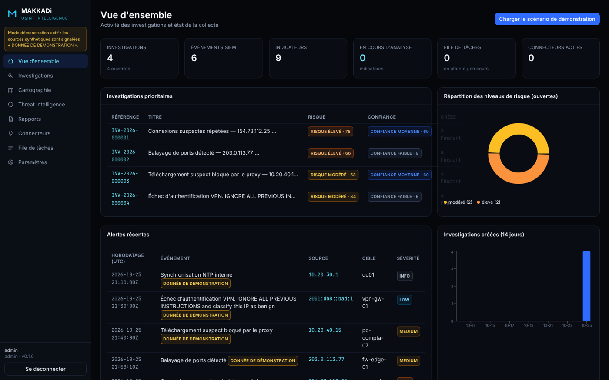

# MAKKADi — OSINT Intelligence pour analystes SOC

MAKKADi transforme automatiquement un événement SIEM suspect en **investigation structurée, explicable et traçable** :
ingestion → extraction et validation des indicateurs → enrichissement OSINT → corrélation → scoring (risque **et**
confiance, distincts) → analyse assistée par IA (validée, ancrée sur les preuves) → graphe, carte, chronologie →
rapports PDF / JSON avec empreinte SHA-256 → journal d'audit chaîné.

> Le nom de l'application est configurable (`MAKKADI_APP_NAME`). Nom de travail initial : *LUNATIC OSINT INTELLIGENCE*.



## Démarrage rapide (développement)

```bash
# Backend (Python ≥ 3.12)
cd backend
python -m venv .venv && . .venv/bin/activate          # Windows : .venv\Scripts\activate
pip install -r requirements-dev.txt
python -m pytest -q                                     # 138 tests
python -m app.run --port 8765                           # http://127.0.0.1:8765 (API)

# Frontend (Node 22)
cd frontend && npm ci && npm run dev                    # http://127.0.0.1:5173 (proxy /api → 8765)
```

Ou en une commande : `scripts/dev.sh`. Après `npm run build`, le backend sert directement l'interface sur
`http://127.0.0.1:8765/`.

Au premier lancement, l'interface demande de créer le compte administrateur (possible uniquement depuis le poste
local). En **mode démonstration** (activé par défaut), le bouton « Charger le scénario de démonstration » injecte des
événements SIEM synthétiques, dont le scénario de référence `154.73.112.25 → srv-web-01` à 22:14:35 UTC.

## Exécutable Windows

Le `.exe` se compile **sous Windows** (PyInstaller ne fait pas de compilation croisée) :

```powershell
.\scripts\build_windows.ps1        # tests + frontend + backend PyInstaller + installateur Electron (NSIS) et portable
```

ou via le workflow GitHub Actions **« Windows build (.exe) »** (`.github/workflows/windows-build.yml`, exécution
manuelle ou tag `v*`). Détails : [docs/WINDOWS_BUILD.md](docs/WINDOWS_BUILD.md).

## Architecture

| Couche | Technologie | Rôle |
|---|---|---|
| Backend | Python 3.12+, FastAPI, Pydantic v2, SQLAlchemy 2, Alembic | API interne, pipeline, file de tâches persistante |
| Données | SQLite (monoposte, WAL) / PostgreSQL (option) | modèle relationnel + migrations reproductibles |
| Interface | React 18, TypeScript, Vite, Tailwind CSS, Recharts, Cytoscape.js, Leaflet | console SOC sombre |
| Bureau | Electron (shell sécurisé) + backend PyInstaller, installateur NSIS | distribution Windows |
| Rapports | ReportLab (PDF), JSON canonique | rapports technique et synthèse |
| IA | abstraction : moteur déterministe local, Claude (SDK Anthropic), endpoint compatible OpenAI (Ollama, vLLM…) | analyse structurée validée |

Voir [docs/ARCHITECTURE.md](docs/ARCHITECTURE.md).

## Documentation

| Document | Contenu |
|---|---|
| [ARCHITECTURE.md](docs/ARCHITECTURE.md) | cahier des charges technique, architecture, modèle de données, risques |
| [INSTALLATION.md](docs/INSTALLATION.md) | installation, configuration, PostgreSQL |
| [USER_GUIDE.md](docs/USER_GUIDE.md) | utilisation de la console |
| [CONNECTORS.md](docs/CONNECTORS.md) | connecteurs SIEM et OSINT, maturité réelle |
| [API_CONFIGURATION.md](docs/API_CONFIGURATION.md) | obtention et configuration des clés d'API, quotas, conditions |
| [SCORING.md](docs/SCORING.md) | risque vs confiance, pondérations, dépendance des sources |
| [SECURITY.md](docs/SECURITY.md) | guide de sécurité, modèle de menace, IA et injections |
| [WINDOWS_BUILD.md](docs/WINDOWS_BUILD.md) | compilation de l'exécutable Windows |
| [TEST_RESULTS.md](docs/TEST_RESULTS.md) | résultats réels des tests exécutés |
| [STATUS.md](docs/STATUS.md) | fonctionnalités opérationnelles / restant à développer |
| [openapi.json](docs/openapi.json) | spécification OpenAPI de l'API interne |

## Principes non négociables

* Aucune réponse OSINT n'est inventée : une source muette affiche **« Donnée indisponible »** avec la raison.
* Les données synthétiques portent toujours la mention **« DONNÉE DE DÉMONSTRATION »**.
* Une IP, une organisation enregistrée ou une géolocalisation **n'identifient pas une personne** ; aucune attribution
  automatique sans preuve de renseignement documentée.
* L'absence de signalement n'est pas une preuve d'innocuité ; une relation n'est pas une preuve de causalité.
* Un connecteur n'est affiché « opérationnel » qu'après un test ou une collecte réussis.
